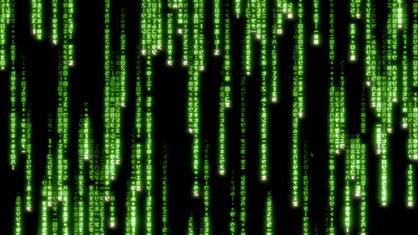
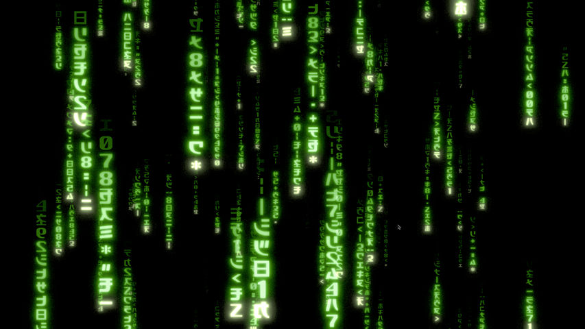
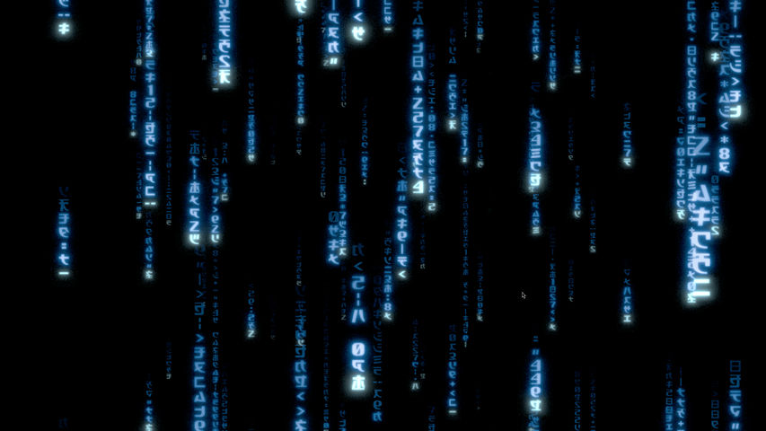
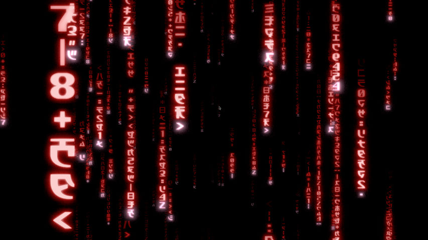
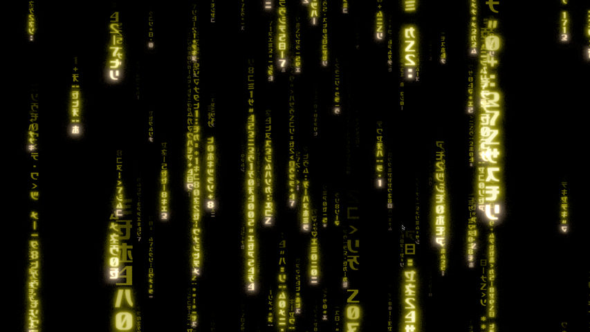

# Matrix Screensaver

A native Rust Matrix animation with modern 3D and classic 2D rain. It renders rain, bloom, and color entirely on the GPU. It runs in a resizable window by default or opens full-screen windows with `--screensaver`.

## Previews

### Matrix Classic Green



### Matrix Modern Green



### Matrix Modern Blue



### Matrix Modern Red



### Matrix Modern Yellow



## Build and run

On Arch/Omarchy, install a Rust toolchain and native build prerequisites:

```bash
sudo pacman -S rustup base-devel
rustup default stable
cargo run
```

## Options

| Setting | Values | Default | Description |
|---|---|---|---|
| Effect | `modern`, `classic` | `modern` | Selects perspective 3D rain or flat 2D rain. |
| Color | `green`, `blue`, `red`, `yellow`, `purple`, `orange` | `green` | Changes the rain, glow, and bright cursor palette. |
| Frame rate | `1` through `60` FPS | `30` | Higher values produce smoother motion and use more GPU power. |
| Render scale | `0.25` through `1` | `0.5` | Controls internal resolution. Higher values are sharper and require more GPU work. |

On Linux, configure these settings with command-line options:

```bash
matrix-screensaver \
  --type modern \
  --color green \
  --fps 30 \
  --render-scale 0.5
```

Use `--screensaver` to open full-screen windows on every active monitor. Wayland idle-manager integrations can also use `--app-id ID` to select the application ID. Run `matrix-screensaver --help` for the complete command-line usage.

The packaged Windows and macOS screensavers provide these four visual settings through their native configuration interfaces, so normal users do not need command-line options. On Windows, open **Screen Saver Settings**, select Matrix Screensaver, and choose **Settings**. On macOS, select Matrix Screensaver under **System Settings > Screen Saver**, then open **Options**. Both interfaces let you choose the effect, color, frame rate, and render scale, and save those choices for later previews and full-screen runs.

## Rendering and development

The project enables Wayland and X11 backends in `winit`; on Omarchy it will use the Wayland session. It requests a native `wgpu` adapter and reports a readable failure if no compatible GPU surface or device is available.

The glyph atlas and WGSL shaders are compiled into the executable. Running the binary does not fetch assets or require a browser, network connection, or working-directory-relative asset path. The active settings and GPU resource formats are documented in [renderer details](docs/renderer.md).

For visual regression checks, choose a starting window size without changing the renderer:

```bash
MATRIX_WINDOW_SIZE=1280x720 cargo run
MATRIX_WINDOW_SIZE=720x1280 cargo run
MATRIX_WINDOW_SIZE=1024x1024 cargo run
```

The default `--type modern` renders the 3D effect internally at 50% of the window's physical size and targets 30 FPS. This setting added about 3–4 W of GPU board power over idle in the single-monitor benchmark. Run `--type classic` for flat Matrix rain with a black, staggered startup. For a sharper image and smoother animation, use `./target/release/matrix-screensaver --type classic --fps 60 --render-scale 0.75`. The same quality settings work with modern:

```bash
./target/release/matrix-screensaver --fps 60 --render-scale 0.75
```

Build first with `cargo build --release`. Select the effect with `--type modern|classic`; override either quality setting with `--render-scale 0.25..1` and `--fps 1..60`; for example, `./target/release/matrix-screensaver --fps 60 --render-scale 1` uses full internal resolution. Run `./target/release/matrix-screensaver --help` for usage. The `MATRIX_RENDER_SCALE` and `MATRIX_FPS` environment variables remain supported for existing scripts; command-line values take precedence. Integrated graphics are supported when the driver provides a compatible adapter. The app exits with a clear error on a CPU software adapter because that path has not met the screensaver's low-power target.

Choose a palette with `--color green|blue|red|yellow|purple|orange`. Green is the default and retains the original Matrix colors. The choice works with both `--type modern` and `--type classic`; for example, `./target/release/matrix-screensaver --type classic --color blue`.

To try the full-screen mode, run `./target/release/matrix-screensaver --screensaver --type modern` (or `--type classic`). It creates one window per active monitor and exits on a key press, mouse click, scroll, touch, pointer movement past a small threshold, or loss of focus after a short grace period. The binary does not lock the session. Temporary-output add and removal passed on the tested Hyprland session; physical unplug and suspend still need validation. See [Step 4 validation](docs/validation.md#step-4-linux-screensaver-mode).

For Omarchy, the tested user-owned `leomoon.idle` clone launches `--screensaver --app-id org.omarchy.matrix-screensaver` and tracks that class. A separate class is required because Omarchy routes its packaged terminal screensaver class to a hidden workspace. The clone is active on the tested machine; its original stay-awake setting remains enabled. To reproduce this integration, run `omarchy plugin clone omarchy.idle`, change the clone’s `screensaverClass` to `org.omarchy.matrix-screensaver`, replace only the `launchScreensaver()` command with the absolute release-binary path plus those two flags, then run `omarchy restart shell`. The existing service still controls idle and lock timing. To revert, run `omarchy plugin remove leomoon.idle --yes` and `omarchy restart shell`. See [Step 4 validation](docs/validation.md#step-4-linux-screensaver-mode).

For archive installation and session-specific Omarchy, hypridle, swayidle, and X11 setup, see the [Linux installation guide](docs/linux-install.md). Xwayland multi-monitor placement is currently not validated as an X11 integration.

On macOS, build the native universal ScreenSaver bundle with `scripts/package-macos.sh`. Install `dist/macos/Matrix Screensaver.saver` through Finder or copy it into `~/Library/Screen Savers/`, then select it in System Settings. The system owns previews, displays, input dismissal, and authentication. See the [macOS installation guide](docs/macos-install.md) and [macOS test checklist](docs/macos-testing.md).

For a 60-second NVIDIA benchmark, build the release binary and run `python scripts/benchmark.py target/release/matrix-screensaver --type classic` (or `--type modern`). It samples idle and running CPU and GPU counters and process memory, and enables 10-second FPS and frame-interval reports. On Hyprland, add `--float --size 1280x720` to measure that physical window size; otherwise tiling can override the requested size. See [validation results](docs/validation.md).

For two connected Hyprland monitors, run `python scripts/benchmark_dual.py target/release/matrix-screensaver --seconds 60`. It starts one instance per monitor and measures both simultaneously. The current default is the measured 30 FPS preset.

For sampled GPU pass timings on an adapter with timestamp-query support, run `MATRIX_PROFILE_GPU=1 target/release/matrix-screensaver`. It reports simulation, rain, bloom, palette, and presentation times every 300 frames.

## Checks

```bash
cargo fmt --check
cargo check
cargo test
```

The standard test command runs pure tests and reports GPU tests as ignored. To run the GPU tests on a machine with a native graphics adapter, use `cargo test --lib -- --ignored --skip capture_native_frame`. The [renderer details](docs/renderer.md#automated-checks) explain what the cross-platform Actions jobs verify.

## Attribution

The bundled glyph atlas and adapted shader design come from [Rezmason/matrix](https://github.com/Rezmason/matrix). See [third-party notices](docs/third-party-notices.md) before redistributing them.
